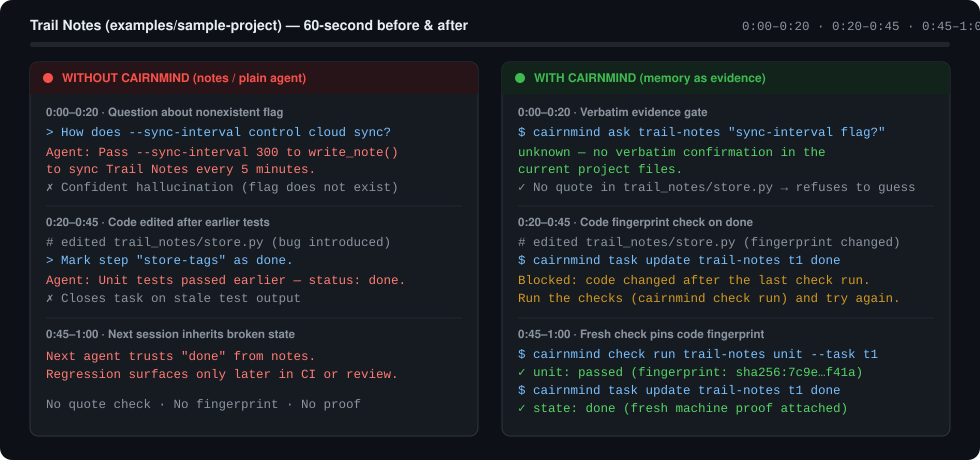
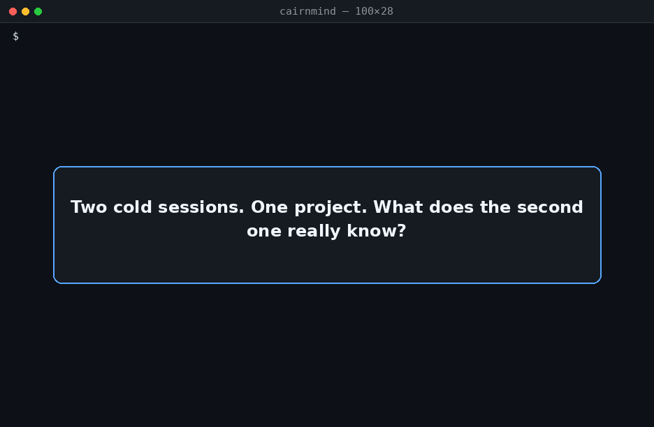

# Cairnmind

[](https://github.com/piotrwozn/cairnmind/actions/workflows/ci.yml)
[](https://github.com/piotrwozn/cairnmind/actions/workflows/ci.yml?query=branch%3Amain+event%3Apush)

**Memory as evidence, not notes. Verified project memory for coding agents.**

1. **Your agent does not guess:** `ask` returns a verbatim quote verified against the current code, or `unknown`.
2. **Your agent does not lie that it finished:** marking a task `done` is blocked if the code changed after the last passing test run.



*60-second before & after on [`examples/sample-project`](examples/sample-project/README.md): **0:00–0:20** hallucinated flag vs. `unknown` · **0:20–0:45** stale `done` blocked after a code edit · **0:45–1:00** fresh check run pins the code fingerprint and unlocks verified `done`.*

**Try Cairnmind in 15 seconds (Python + `uv` only, zero external services, zero files written in your directory):**

```bash
uvx cairnmind try
```

Works on Linux, macOS, and native Windows using an ephemeral in-memory SQLite store over the bundled [`examples/sample-project`](examples/sample-project/README.md). You can also inspect the snapshot directly with `cairnmind memory show examples/sample-project/.memory/cairnmind`.

*A cairn is the pile of stones a walker leaves to mark the trail for the next one. Cairnmind is the durable, versioned memory one coding agent leaves for the next across Codex CLI, Claude Code, GitHub Copilot, API agents and MCP clients. Formerly DevBrain.*

## How it works

Cairnmind runs as a separate local service that coding assistants connect to. It never treats a model's claim as evidence:

- **Verbatim source quotes or `unknown`.** Every `ask` answer must quote the source text verbatim. The service re-checks the quote against the current file and runs a support check before accepting the answer.
- **Read-before-write resume.** A coding session cannot write to memory until it acknowledges the exact plan and task versions it read.
- **Fresh machine proof for `done`.** Test-gated tasks require a passing local check run bound to the current code fingerprint. Editing code invalidates earlier runs.
- **Portable memory.** Snapshots and published team memory travel with the repository through Git without credentials.

The full architecture taxonomy (`origin_evidence`, resume packets, plan versions, check profiles, guarantees and limits) lives in [docs/CONTRACTS.md](docs/CONTRACTS.md#architecture-taxonomy).



**A decision survives a cold hand-off. A passing test does not survive a code change.** One session reads `DESIGN.md` and saves a proposed decision and a verification task. A fresh session starts cold and recovers the decision, the task and its source quote. Then `cairnmind check run` records `Checks fresh`, and a one-line edit in `checkout.py` turns that evidence `Checks stale` without running the test again.

## Quick start

Cairnmind runs on Linux, on Windows (natively on Windows 10/11 or inside WSL2 Ubuntu via `wsl --install -d Ubuntu`, where Ubuntu 24.04 is the tested platform) and on macOS with Apple silicon.

**Lightweight local start (embedded SQLite, Python + `uv` only, zero external services):**

```sh
uvx cairnmind try                                 # 15-second zero-setup sandbox over examples/sample-project
uv tool install cairnmind                         # install the CLI
cairnmind init --backend sqlite                   # initializes local SQLite WAL + FTS5 store in data_dir/state.db
```

Scale losslessly to ArcadeDB at any time with `cairnmind migrate --to server`, or install the full ArcadeDB stack directly below.

**What you need** (full ArcadeDB stack): `uv` (`curl -LsSf https://astral.sh/uv/install.sh | sh`) and one way to run the database. **Java 21** is the simplest (`sudo apt install -y openjdk-21-jre-headless` on Ubuntu/WSL2), or Docker. Nothing else is required upfront: no Ollama, no models, no GPU, no tmux and no coding assistant are needed.

**What gets installed:** the `cairnmind` CLI via `uv`, the local ArcadeDB engine (or SQLite store with `--backend sqlite`), and the read-only health check at the end of installation.

```bash
bash scripts/install-wsl.sh                    # 1. installs Cairnmind + ArcadeDB and runs the readiness check
cairnmind project add my-app ~/src/my-app      # 2. registers your project's folder and indexes its files
cairnmind remember my-app "Accounts lock after five failed logins."   # 3. stores a first finding, as proposed
cairnmind brief my-app                         # 4. where work stands: your finding is listed, marked as unconfirmed
cairnmind ask my-app "When do accounts lock?"  # 5. finds it again; passages of your files that use the question's words are searched too
```

In a terminal, commands explain what happened and how to fix blocks in plain language. With `--json` (or in a pipe/script), `stdout` emits pure JSON while hints and warnings go strictly to `stderr` (`NO_COLOR=1` disables ANSI styling). `cairnmind doctor` repeats the installer's check at any time and exits 1 when something required is missing. Optional integrations (Ollama, `tmux`, NLI via `cairnmind[nli]`, and GitHub Copilot via `cairnmind[copilot]`) are covered under [Optional integrations](#optional-integrations).

- If the installer prints `Add this directory to PATH`, do what that line says and open a new terminal.
- `my-app` is any name you choose, and `~/src/my-app` stands for a project folder (a Git repo with at least one commit unlocks `impact`, coding sessions and commit history in `brief`). To clone and register a repository in one step, use `cairnmind add --clone owner/repo` (or `cairnmind project add [NAME] [FOLDER] --clone REPO`, or an HTTPS/SSH URL directly).
- Findings stored via CLI or assistants start as *proposed* and are immediately usable in `brief` and `ask`. You can confirm or dispute them later in the memory inspector (see [Optional integrations](#optional-integrations)).
- Without local models, `ask` searches passages deterministically without fabricating an answer (`status: unavailable` in `--json`). Enable local models below to turn on cited answers.

### Connect Codex or Claude Code

With [Codex CLI](https://developers.openai.com/codex/cli) or [Claude Code](https://code.claude.com/docs/en/setup) installed and signed in:

```bash
cairnmind install my-app          # connects the installed clients to this project
cairnmind run my-app claude       # or codex: starts the client bound to this project's memory
```

`cairnmind install` writes only for installed clients: a marked Cairnmind block (`AGENTS.md` for Codex, `CLAUDE.md` for Claude Code), its MCP entry and its hooks (`.mcp.json` and `.claude/settings.local.json` for Claude Code, `.codex/config.toml` and `.codex/hooks.json` for Codex). Cairnmind leaves its own block out of the project's index. Review the files before committing.

Cursor, Cline, Zed and other MCP clients connect via `cairnmind mcp --client external` in an evidence-degraded session: see [docs/EXTERNAL_CLIENTS.md](docs/EXTERNAL_CLIENTS.md).

### Fast health checks and universal MCP presets

- **`cairnmind pulse [PROJECT]`**: read-only consistency micro-audit (< 500 ms) checking code drift, test freshness, `origin_evidence: degraded` records, and `.memory/cairnmind/` snapshot/reference integrity. Supports `--json` and `--strict` (exit `0` healthy / soft drift, `1` drift with `--strict`, `2` broken) for CI and `pre-push` hooks.
- **`cairnmind mcp generate --client <name> [--write]`** (or `--auto`): generates and safely deep-merges MCP presets for `claude-code`, `claude-desktop`, `cursor`, `windsurf`, `vscode`, `cline`, `roo-code`, `codex`, `gemini-cli`, `zed` and `generic` (JSON, JSONC and TOML), creating `<file>.cairnmind.bak` backups with atomic writes and never adding auto-approval flags.
- **`cairnmind mcp test-connection`**: verifies a live stdio JSON-RPC `initialize` + `tools/list` handshake and fails hard on any non-JSON-RPC output on `stdout`.
- **`cairnmind doctor --check-mcp`**: combines storage, Memory Pulse, detected MCP presets, a bounded 5-second stdio handshake check, and Docker/WSL/permissions pre-flight diagnostics in one report.

**[Step-by-step installation guide](docs/INSTALL.md)**: preparing Windows and WSL2 (Ubuntu 24.04 is the tested platform for the full ArcadeDB + tmux setup, while macOS and native Windows lightweight mode are also supported), installing from a release, native or Docker engine, connecting assistants, upgrading, uninstalling and troubleshooting. To see what Cairnmind keeps before you install anything, read the [sample project memory](examples/sample-project/README.md) (`examples/sample-project`).

## Optional integrations

### Local models (Ollama)

With [Ollama](https://ollama.com) running ([installation, step 2](docs/INSTALL.md#2-install-system-tools)):

```bash
cairnmind models pull            # downloads qwen3.5:9b and qwen3-embedding:0.6b into Ollama (about 7 GB)
cairnmind stop                   # the service reads the choice on next start
```

`cairnmind models pull` enables cited answers, semantic vectors and background extraction. `cairnmind models set` points at another Ollama or an OpenAI-compatible HTTPS server ([docs/API.md](docs/API.md#the-knowledge-agents-models)).

### Terminal workspace (tmux 3.4+ / Windows standalone)

On Linux, WSL2 and macOS, with tmux 3.4+ (`sudo apt install tmux`, or `brew install tmux` on macOS), `cairnmind` opens the multi-pane workspace: Codex and Claude Code run in panes beside the projects, the memory inspector and the graph ([docs/TERMINAL.md](docs/TERMINAL.md)). On native Windows, `cairnmind` opens the standalone Textual workspace directly in Windows Terminal or PowerShell without requiring tmux, backed by an owner-only Windows Named Pipe for person-confirmed actions. In the POSIX workspace, `Ctrl+B then i` opens the memory inspector. In the native Windows standalone workspace, press `2` for Memory. Every other CLI command works without `tmux`.

### Local web UI inspector (`cairnmind ui`)

An optional loopback-only browser inspector (`http://127.0.0.1:4310`) for viewing OCC session alignment, task test gates, verbatim quote provenance with SHA-256 fingerprint diffs, the 4-column dependency & blast-radius graph, and the MCP guardrail audit log alongside a running Cairnmind workspace or service. Build the static frontend bundle once (requires Node.js 20+):

```bash
cd ui && npm install && npm run build
```

Then run `cairnmind ui` in a separate terminal alongside Cairnmind:

```bash
cairnmind ui --port 4310                    # live mode against your local Cairnmind store (latest project)
cairnmind ui --port 4310 --project my-app   # inspect a specific registered project
cairnmind ui --port 4310 --mock             # preview all states with deterministic sample data (no database needed)
```

Pass `--no-open` to skip opening a browser tab automatically. The server binds strictly to loopback (`127.0.0.1`, `localhost`, or `::1`), streams live updates over SSE (`/api/ui/events`), and provides `Ctrl+K` search and `j`/`k`/`1`–`4`/`Esc` keyboard navigation.

## How it compares

| | Instruction file (`CLAUDE.md`, `AGENTS.md`) | Memory built into an assistant | Memory plugin or layer | Cairnmind |
|---|---|---|---|---|
| Who writes it | You, by hand | The model | The model | The model and you, each record tied to a source |
| Checked against the source | No | Usually no | Usually no | Every cited quote must occur literally in a current source |
| Works across assistants | Each assistant reads its own file | No | Depends on the plugin | Codex CLI, Claude Code, Copilot, API agents and external MCP clients |
| "Done" needs proof | No | No | Usually no | Fresh local check run bound to the current code fingerprint |
| Setup | None | None | Usually one command | Java 21 or Docker + `uv` (Ollama and `tmux` are optional) |

For the complete guarantees-vs-non-guarantees table and known limits, see [docs/CONTRACTS.md](docs/CONTRACTS.md#what-it-guarantees-and-what-it-does-not). Shared team memory works through Git ([Team memory](docs/MEMORY.md#team-memory)).

## Measured results

Measured with `qwen3.5:9b` and `qwen3-embedding:0.6b` on an RTX 4080 Super in isolated databases (0.11.0 / 0.12.0 release gate, see [docs/EVALUATION.md](docs/EVALUATION.md) and [docs/evaluation/RESULTS.md](docs/evaluation/RESULTS.md)):

| Evaluation | Result |
|---|---|
| Recall: 20 golden questions (threshold 0.9) | 1.0 on 0.11.0 and 0.12.0 · 1.0 in 6 of 6 runs on 0.8.0 |
| Portable memory: extraction, transfer, cited recall, project isolation | passed on 0.11.0 and 0.12.0 · 3 of 3 runs on 0.8.0 |
| Extraction from conversations (rejected share) | 29% of 28 proposals (down from 65% on 0.10.0), every kept record found |
| Questions about Cairnmind's own repository (complete and right) | 19–20 of 20 · none complete and wrong |
| Questions about absent features, refused | 20 of 21 (24 of 24 after subject/names checks, see [RESULTS.md](docs/evaluation/RESULTS.md)) |

## Documentation

Version 0.12.0 is the current release. See [CHANGELOG.md](CHANGELOG.md), [docs/UPGRADING.md](docs/UPGRADING.md) and the [roadmap issues](https://github.com/piotrwozn/cairnmind/issues?q=is%3Aissue+label%3Aroadmap).

- [docs/STABLE_CONTRACT.md](docs/STABLE_CONTRACT.md): what the `1.x` stable contract covers (CLI `--json`, MCP tools, persistent formats, settings, safety rules, deprecation policy, supported matrix and PR enforcement).
- [docs/CONTRACTS.md](docs/CONTRACTS.md): architecture taxonomy, guarantees, limits, implementation contracts and [extension surfaces](docs/CONTRACTS.md#extension-surfaces).
- [docs/INSTALL.md](docs/INSTALL.md): installation, native or Docker engine, models, verification and troubleshooting.
- [docs/WORKFLOW.md](docs/WORKFLOW.md): plans, check profiles, code fingerprints, evidence states, MCP tools, `brief`, `usage`, `impact`, [symbol-anchored evidence](docs/WORKFLOW.md#symbol-anchored-evidence), [opt-in code decisions](docs/WORKFLOW.md#opt-in-decisions-from-code-comments-adr-trailers) and [serverless CI `scan`](docs/WORKFLOW.md#serverless-ci-check-cairnmind-scan).
- [docs/MEMORY.md](docs/MEMORY.md) & [docs/MEMORY_CONTRACTS.md](docs/MEMORY_CONTRACTS.md): portable snapshots, team memory, secrets gate and import rules.
- [docs/TERMINAL.md](docs/TERMINAL.md): terminal workspace, memory inspector and keyboard shortcuts.
- [docs/EXTERNAL_CLIENTS.md](docs/EXTERNAL_CLIENTS.md): Cursor, Cline, Zed and other external MCP clients.
- [docs/STORAGE_AND_MAINTENANCE.md](docs/STORAGE_AND_MAINTENANCE.md): data directory, backups, single writer, migration and maintenance.
- [docs/API.md](docs/API.md): API, Ollama, Copilot connections, sensitivity classes and third-party MCP tools.
- [docs/EVALUATION.md](docs/EVALUATION.md): explicit evaluations and measured results.
- [docs/DEPLOYMENT.md](docs/DEPLOYMENT.md): containers, remote servers, Kubernetes and connect-only installations.
- [docs/UPGRADING.md](docs/UPGRADING.md): upgrading an existing installation.
- [docs/ARCHITECTURE.md](docs/ARCHITECTURE.md): system architecture, dependencies, repository layout and dev commands.
- [CHANGELOG.md](CHANGELOG.md): release history.

## Contributing

Contributions are welcome. Read [CONTRIBUTING.md](CONTRIBUTING.md) first, and report vulnerabilities as described in [SECURITY.md](SECURITY.md).

## License

Cairnmind is licensed under the [Apache License 2.0](LICENSE). ArcadeDB is licensed separately under the same license. See [NOTICE](NOTICE).
